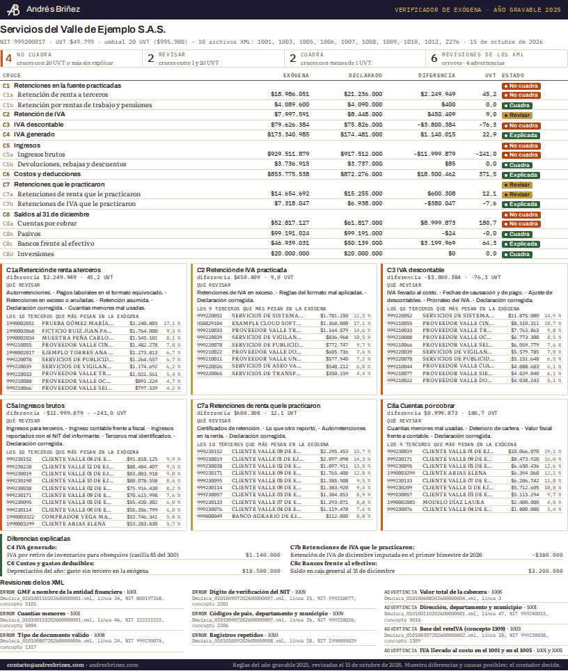
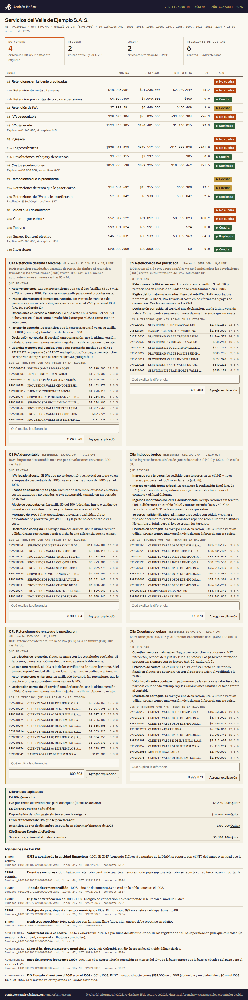
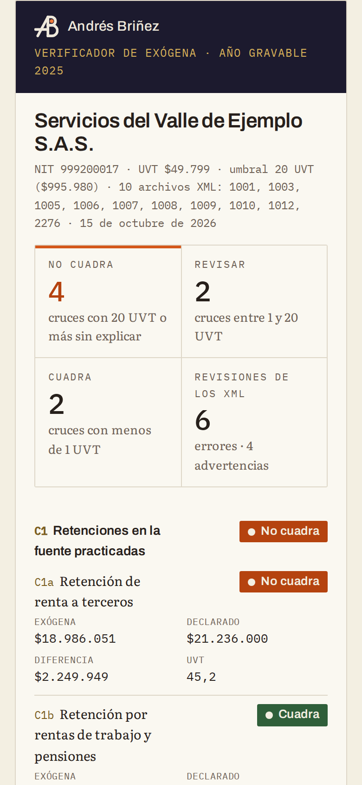
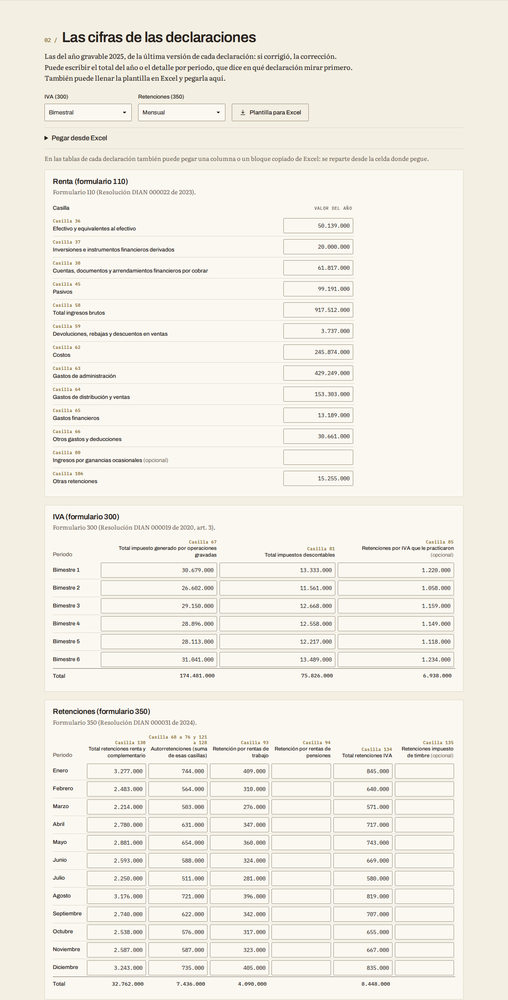
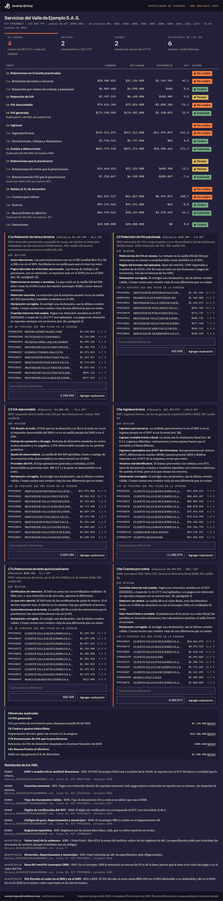
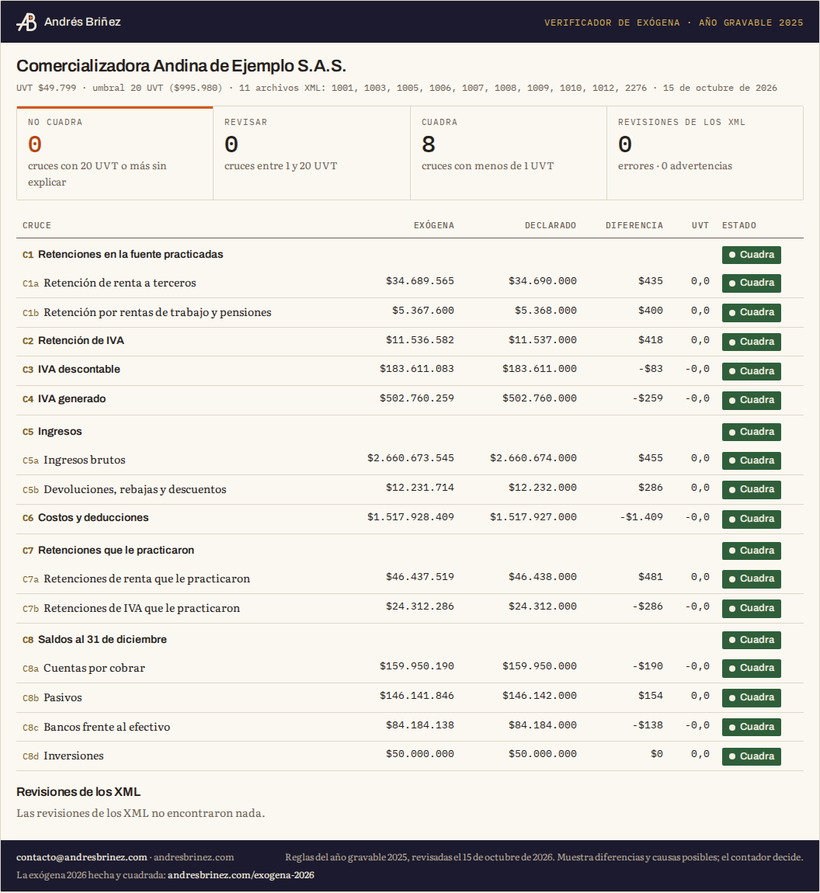

# Verificador de exógena

Cruza la exógena del año gravable 2025 que ya presentó con su renta (formulario 110), su IVA (300) y sus
retenciones (350), y muestra con semáforo dónde no cuadra. Es un solo archivo, `verificador-exogena.html`,
que se abre con doble clic y funciona sin internet. Sus datos no salen del computador.



## Qué hace

Usted carga los XML de la exógena del año gravable 2025 tal como los presentó y escribe (o pega desde
Excel) unas cifras de sus declaraciones del mismo año. La página arma un informe de una hoja por cliente:

- **Ocho cruces con semáforo**, de C1 a C8: retenciones practicadas, retención de IVA, IVA descontable,
  IVA generado, ingresos, costos y deducciones, retenciones que le practicaron y saldos al 31 de
  diciembre. Cada cruce muestra la cifra de la exógena, la declarada y la diferencia en pesos y en UVT.
- **Qué revisar** en cada diferencia: las causas típicas de ese cruce.
- **Los 10 terceros que más pesan** en la cifra de la exógena de cada cruce que no cuadra: por ahí se
  empieza a buscar.
- **Explicaciones**: si usted ya sabe por qué hay una diferencia (la depreciación del año, el dinero en
  caja), la escribe con su valor; el verificador la descuenta y la línea queda como «Explicada».
- **Revisiones de los XML**: estructura contra los esquemas oficiales, dígito de verificación del NIT,
  tipos de documento, registros repetidos, cuantías menores, GMF, base del reteIVA y las demás de la lista
  de abajo.

Además descarga un CSV con todo para el papel de trabajo y da un resumen sin NIT ni nombres de terceros,
para pedir ayuda sin compartir datos de terceros.

| La empresa de ejemplo con diferencias, en pantalla | En el teléfono |
| --- | --- |
|  |  |

## Cómo usarlo

1. Copie `verificador-exogena.html` en su computador y ábralo con doble clic. Sirve Chrome, Edge, Firefox
   o Safari, en Windows o en Mac, y no necesita internet ni instalar nada.
2. **Los XML.** Arrástrelos a la página o elíjalos: los del año gravable 2025 que presentó (1001, 1003,
   1005, 1006, 1007, 1008, 1009, 1010, 1012 y 2276, los que tenga). Si un formato salió en varios
   archivos, cárguelos todos; si hubo reemplazos, solo los vigentes. Si no los tiene, se bajan de la DIAN
   en el servicio donde se consulta lo ya presentado.
3. **Las cifras.** Escriba las de la última versión de cada declaración (si corrigió, la corrección). Puede
   poner el total del año o el detalle por periodo: bimestral o cuatrimestral para el IVA y mensual para
   las retenciones. También puede bajar la **plantilla para Excel**, llenarla y pegarla, o pegar una
   columna de Excel directo en la tabla.
4. **El informe.** Aparece solo y se rehace con cada cambio. Agregue las explicaciones que conozca,
   cambie el umbral si quiere y use **Imprimir o guardar en PDF**, **Descargar todo en CSV** o **Copiar
   resumen sin NIT**. Con **Empezar otro cliente** la página queda en blanco.

Para verlo antes de usar sus archivos, toque **Empresa con diferencias** o **Empresa que cuadra**: son dos
empresas ficticias con sus XML y sus cifras.



| Modo oscuro | La empresa que cuadra |
| --- | --- |
|  |  |

## Las cifras que se piden

Las casillas son las de los formularios vigentes para el año gravable 2025: el 110 de la Resolución
000022 de 2023, el 300 de la Resolución 000019 de 2020 y el 350 de la Resolución 000031 de 2024.

| Declaración | Casilla | Qué es | Cruce |
| --- | --- | --- | --- |
| Renta 110 | 36 | Efectivo y equivalentes al efectivo | C8 |
| Renta 110 | 37 | Inversiones e instrumentos financieros derivados | C8 |
| Renta 110 | 38 | Cuentas, documentos y arrendamientos financieros por cobrar | C8 |
| Renta 110 | 45 | Pasivos | C8 |
| Renta 110 | 58 | Total ingresos brutos | C5 |
| Renta 110 | 59 | Devoluciones, rebajas y descuentos en ventas | C5 |
| Renta 110 | 62, 63, 64, 65 y 66 | Costos; gastos de administración; de distribución y ventas; financieros; otros gastos y deducciones | C6 |
| Renta 110 | 80 | Ingresos por ganancias ocasionales (opcional) | C5 |
| Renta 110 | 106 | Otras retenciones (las que le practicaron) | C7 |
| IVA 300 | 67 | Total impuesto generado por operaciones gravadas | C4 |
| IVA 300 | 81 | Total impuestos descontables | C3 |
| IVA 300 | 85 | Retenciones por IVA que le practicaron (opcional) | C7 |
| Retenciones 350 | 130 | Total retenciones renta y complementario | C1 |
| Retenciones 350 | 68 a 76 y 121 a 128 | Autorretenciones, en una sola cifra | C1 |
| Retenciones 350 | 93 y 94 | Retención por rentas de trabajo y de pensiones | C1 |
| Retenciones 350 | 134 | Total retenciones IVA | C2 |
| Retenciones 350 | 135 | Retenciones de timbre (opcional) | C1 |

Con los totales del año son unas veinte cifras; con el detalle por periodo, cerca de cien. Las opcionales
abren una línea más en su cruce.

## Cómo se calcula cada cruce

La diferencia es **lo declarado menos la exógena**. Lo que usted explica se descuenta, y el semáforo mira lo
que queda sin explicar.

| Línea | Exógena | Declarado |
| --- | --- | --- |
| C1a Retención de renta a terceros | 1001: retención practicada y asumida de renta, sin timbre (5053 y 5054) ni retención trasladada (5086); las devoluciones de años anteriores (5028) restan | 350: casilla 130 menos autorretenciones y menos casillas 93 y 94 |
| C1b Retención por rentas de trabajo y pensiones | 2276: retenciones (vare) | 350: casillas 93 y 94 |
| C1c Retención de timbre (si escribe la casilla) | 1001: concepto 5053, menos 5054 | 350: casilla 135 |
| C2 Retención de IVA | 1001: retención de IVA a responsables y a no domiciliados (5028 resta); 2276: retención de IVA | 350: casilla 134 |
| C3 IVA descontable | 1005: impuesto descontable más IVA por devoluciones en ventas (el IVA llevado al costo no entra) | 300: casilla 81 |
| C4 IVA generado | 1006: impuesto generado más IVA recuperado en devoluciones en compras (el impuesto al consumo no entra: va en el 310) | 300: casilla 67 |
| C5a Ingresos brutos | 1007: ingresos brutos sin los de ganancia ocasional (4019 y 4021) | 110: casilla 58 |
| C5b Devoluciones | 1007: devoluciones, rebajas y descuentos | 110: casilla 59 |
| C5c Ganancias ocasionales (si escribe la casilla) | 1007: conceptos 4019 y 4021 | 110: casilla 80 |
| C6 Costos y deducciones | 1001: pagos deducibles de los conceptos de costo o gasto, más el IVA llevado al costo deducible; 2276: total de ingresos brutos por rentas de trabajo, más el IVA llevado al costo | 110: casillas 62 a 66 |
| C7a Retenciones de renta que le practicaron | 1003: sin la de IVA (1309) ni la de timbre (1314) | 110: casilla 106 |
| C7b Retenciones de IVA que le practicaron (si escribe la casilla) | 1003: concepto 1309 | 300: casilla 85 |
| C8a Cuentas por cobrar | 1008: conceptos 1315, 1316 y 1317, menos el deterioro fiscal (1318) | 110: casilla 38 |
| C8b Pasivos | 1009: todos los saldos | 110: casilla 45 |
| C8c Bancos frente al efectivo | 1012: cuentas corrientes y de ahorro (1110 y 1115) | 110: casilla 36, que incluye la caja |
| C8d Inversiones | 1012: conceptos 1200 a 1206 | 110: casilla 37 |

En el 1001, qué conceptos entran en C6 está en la lista de conceptos de `src/reglas-ag2025.js`: quedan
fuera las compras de activos fijos (5008 y 5020), los gastos pagados por anticipado (5029 a 5035), los
dividendos y los movimientos de patrimonio, las bases informativas y las devoluciones de años anteriores.
Cada exclusión dice por qué.

**El semáforo:**

- **Verde (Cuadra):** lo que queda sin explicar es menos de 1 UVT. Si había una diferencia y usted la
  explicó, dice **Explicada**.
- **Amarillo (Revisar):** desde 1 UVT hasta el umbral.
- **Rojo (No cuadra):** desde el umbral. Por defecto, 20 UVT de 2025 (COP 995.980); se cambia en la página.
- **Sin datos:** falta el formato o la cifra declarada; el informe dice cuál.

Cada cruce toma el peor estado de sus líneas. Las fichas de arriba cuentan cruces.

**Por periodo:** la exógena es anual, así que el cruce se hace con la suma del año. El detalle por periodo
avisa qué periodos quedaron sin cifra y queda en el CSV para ubicar la declaración que conviene mirar.

## Revisiones de los XML

| Revisión | Qué mira | Gravedad | De dónde sale |
| --- | --- | --- | --- |
| XML bien formado | Etiquetas que abren y cierran, atributos, comillas, referencias | Error | Anexos técnicos, numeral 2 |
| Estructura según el esquema | Elemento raíz, registros, atributos obligatorios y permitidos, tipos, largos y patrones | Error | Esquemas XSD oficiales |
| Cabecera | Los diez elementos, su orden y sus valores; concepto 1 o 2 | Error | Anexos técnicos, numeral 2.1 |
| Versión del formato | La del año gravable 2025 (1001 versión 10, 1005 versión 8...) | Error | Resoluciones 000162 y 000188; Concepto 010627 |
| Año gravable | Fechas inicial y final de 2025 | Error | Anexos técnicos, numeral 2.1 |
| Cantidad de registros | CantReg igual a los registros; máximo 5.000 por archivo | Error | Anexos técnicos, numeral 2.1 |
| Valor total | ValorTotal igual a la suma del atributo que fija cada anexo | Advertencia | Anexos y prevalidador |
| Codificación | ISO-8859-1, la que pide la especificación | Advertencia | Anexos técnicos, numeral 2 |
| Nombre del archivo | Si sigue el estándar Dmuisca_, que coincida con la cabecera | Advertencia | Anexos técnicos, numeral 1 |
| Archivos repetidos, envíos repetidos e inserción con reemplazo | El mismo archivo dos veces se cuenta una; los demás casos se avisan | Información y advertencia | Anexos técnicos |
| Dígito de verificación | Módulo 11 de la DIAN para el tipo de documento 31 | Error | Anexos técnicos |
| Tipo de documento | Tabla 1 (con el 43) o tabla 2 (sin el 43), según el formato | Error | Resolución 000162, art. 66 |
| Número de identificación | Sin letras para los documentos numéricos | Advertencia | Prevalidador |
| NIT especiales | 222222222 y 444444001 a 444449999 con el tipo 43, y el 43 solo para ellos | Advertencia | Resolución 000162, arts. 20 a 28 |
| Registros repetidos | La llave de cada formato no se repite | Error | Anexos técnicos |
| Cuantías menores | Sin pagos con retención en el 222222222; razón social «CUANTÍAS MENORES» | Error y advertencia | Resolución 000162, art. 20, par. 1 |
| Cuantías menores fuera de lugar | El 222222222 en formatos que no lo prevén | Advertencia | Resolución 000162 |
| GMF | El concepto 5101 a nombre de la entidad financiera, no de la DIAN | Error | Resolución 000188, art. 3 (par. 16 del art. 20) |
| Base del reteIVA | En el 1309, retención de menos del 10 % de la base: la base parece el pago y no el IVA | Advertencia | Criterio; la 000233 lo aclara para el AG 2026 |
| IVA llevado al costo | El mismo valor en el 1001 y en el 1005, como pide el AG 2025 | Advertencia | Resolución 000162, art. 20, par. 3, y art. 23 |
| Dirección | Si el país es Colombia, dirección, departamento y municipio | Advertencia | Anexos técnicos |
| Códigos de país, departamento y municipio | Que existan en las tablas de la DIAN | Error | Tablas del prevalidador |
| Concepto | Que exista para el formato en el AG 2025 | Error | Tablas de conceptos de la resolución |
| Nombre del tercero | Apellido y nombre para personas naturales; razón social o nombre para las demás | Advertencia | Anexos técnicos |
| Valores en cero | Registros con todos los valores en cero | Advertencia | Prevalidador |
| NIT del informante | Conceptos que van con el NIT de la empresa (5088, 4015, 4016, 4018, 2207, 2216 y 2217), si usted escribe el NIT | Advertencia | Resolución 000162, arts. 20, 22 y 25 |
| Formatos que faltan | Según las cifras declaradas (por ejemplo, retenciones en el 350 sin 1001) | Advertencia | Criterio sobre la Resolución 000162 |

Los formatos 1004, 1010, 1011, 1647 y 2275 se leen y se revisan, pero no entran en los cruces. Otros formatos
(1056, 5247 a 5252, la serie 2820) se listan como no revisados.

## Lo que no hace

- No corrige ni presenta nada, y no consulta la DIAN.
- No da concepto tributario: muestra diferencias y causas posibles, y usted decide.
- No lee los PDF de las declaraciones: las cifras se escriben o se pegan.
- No cruza contra lo que reportaron terceros, contra la factura electrónica ni contra los bancos, y no
  revisa consorcios ni contratos de colaboración.
- No genera la exógena del año gravable 2026.
- Solo trabaja el año gravable 2025, con sus versiones de formato. Un archivo de otro año o de otra versión
  se avisa y queda fuera de los cruces.

## De dónde salen las reglas

Todas consultadas el 15 de octubre de 2026.

| Norma | Qué se tomó | URL |
| --- | --- | --- |
| Resolución DIAN 000162 de 2023 | Formatos, versiones, conceptos, cuantías y anexos técnicos con sus esquemas XSD (año gravable 2024 y siguientes) | https://normograma.dian.gov.co/dian/compilacion/docs/resolucion_dian_0162_2023.htm (anexos en http://168.61.69.177/documentospdf/PDF/R_DIAN_0162_2023.pdf) |
| Resolución DIAN 000188 de 2024 | Cambios desde el AG 2025: conceptos del 1001 y del 1007, GMF (5101), anexos del 1005 y del 1010 | https://normograma.dian.gov.co/dian/compilacion/docs/resolucion_dian_0188_2024.htm (anexo en https://normograma.com/documentospdf/PDF/R_DIAN_0188_2024_ANEXO.pdf) |
| Concepto DIAN 010627 de 2026 | El AG 2025 se rige por la 000162 y la 000188; el AG 2026, por la 000233 y la 000237 | https://normograma.dian.gov.co/dian/compilacion/docs/oficio_dian_10627_2026.htm |
| Resolución DIAN 000227 de 2025 (Única) | Compilación de las anteriores y de los formularios | https://normograma.dian.gov.co/dian/compilacion/docs/resolucion_dian_0227_2025.htm |
| Prevalidador Tributario Informantes AG2025 v3.3.0-26 (19 de marzo de 2026) | Los esquemas XSD de cada formato, las tablas de conceptos, tipos de documento, países, departamentos y municipios, y el atributo que suma el ValorTotal | https://storagecdndian.blob.core.windows.net/site/Transaccional/PREVALIDADORES/Prevalidador_Tributario_Informantes_AG2025_v3.3.0-26.zip (página: https://www.dian.gov.co/Transaccional/Paginas/Prevalidadores-Informacion-Tributaria.aspx) |
| Resolución DIAN 000193 de 2024 | UVT de 2025: COP 49.799 | https://normograma.dian.gov.co/dian/compilacion/docs/resolucion_dian_0193_2024.htm |
| Formulario 110, Resolución DIAN 000022 de 2023 | Casillas e instructivo de la renta | https://normograma.dian.gov.co/dian/compilacion/docs/resolucion_dian_0022_2023.htm y https://www.dian.gov.co/atencionciudadano/formulariosinstructivos/Formularios/2026/Formulario_110_2026.pdf |
| Formulario 300, Resolución DIAN 000019 de 2020, art. 3 | Casillas e instructivo del IVA | https://normograma.dian.gov.co/dian/compilacion/docs/resolucion_dian_0019_2020.htm y https://www.dian.gov.co/atencionciudadano/formulariosinstructivos/Formularios/2025/Formulario_300_2025.pdf |
| Formulario 350, Resolución DIAN 000031 de 2024 | Casillas e instructivo de las retenciones (desde el 1 de agosto de 2024) | https://normograma.dian.gov.co/dian/compilacion/docs/resolucion_dian_0031_2024.htm y https://www.dian.gov.co/atencionciudadano/formulariosinstructivos/Formularios/2026/Formulario_350_2026.pdf |
| Resolución DIAN 000233 de 2025 | Solo como referencia: aclara para el AG 2026 que la base del 1309 es el IVA | https://normograma.dian.gov.co/dian/compilacion/docs/resolucion_dian_0233_2025.htm |
| Mensaje de la DIAN sobre el AG 2024, citado por Gerencie | El umbral de 20 UVT (pendiente de confirmar) | https://www.gerencie.com/qa/que-hacer-cuando-la-dian-informa-de-posibles-inconsistencias-en-la-informacion-exogena-2323/ |

**Cómo se comprobaron.** Los esquemas XSD salieron del prevalidador oficial, abierto con `innoextract`
sin ejecutar el instalador ni las macros. Coinciden con los que trae el texto de los anexos de la
Resolución 000162 y de la 000188 en el nombre, la obligatoriedad, el largo y el patrón de cada atributo.
Solo difieren en el tipo base del 1005 (decimal en el prevalidador, entero en la 000188, con el mismo patrón
de dígitos) y en el patrón del correo del 1004 y el 2275. Las versiones del prevalidador (1001 versión 10, 1005
versión 8, 1010 versión 9...) son las que fija el Concepto 010627 para el AG 2025. Un medio del sector dijo
que el 1001 del AG 2025 era la versión 11, pero esa es la del AG 2026. Los conceptos que el verificador toma
de la resolución son los mismos códigos de las tablas del prevalidador, y una prueba lo revisa.

**Las reglas son datos.** Todo lo que depende de la norma está en tres archivos de `src/`:

- `reglas-ag2025.js`, escrito a mano: formatos, conceptos, casillas, cruces, causas y parámetros de las
  revisiones, cada uno con su norma. Lo que es criterio del verificador y no de la norma lo dice.
- `esquemas-ag2025.js`, generado desde los XSD de `norma/xsd-ag2025/` con `npm run datos`.
- `tablas-ag2025.js`, generado desde `norma/prevalidador-ag2025/tablas.json`.

**Para el año gravable 2026**, cuando salga su prevalidador: se copian sus XSD en `norma/xsd-ag2026/`, se
genera `esquemas-ag2026.js`, se copia `reglas-ag2025.js` como `reglas-ag2026.js` y se cambia lo que cambió
(Resoluciones 000233 y 000237: 1001 versión 11, 1005 versión 9 sin el IVA llevado al costo, 1647 versión 3,
conceptos nuevos, formularios y UVT). La lógica de `verificador.js` no cambia; las pruebas dicen si algo
quedó apuntando a un atributo que ya no existe.

## Privacidad

- Todo se calcula en su navegador. La página no tiene servidor, no pide cuentas y no guarda sus archivos:
  lo que carga existe solo en la memoria mientras la pestaña esté abierta.
- Su política de seguridad (`Content-Security-Policy`) prohíbe conectarse a cualquier parte
  (`connect-src 'none'`) y solo deja correr el código de la propia página, identificado por su huella.
  Las tipografías y el logotipo van dentro del archivo: no se baja nada de ningún sitio.
- La prueba de punta a punta abre la página con la red cortada y cuenta toda petición que no sea del
  propio archivo: no sale ninguna.
- No usa inteligencia artificial.
- Lo único que la página recuerda, en su propio navegador, es si usted eligió el modo claro o el oscuro.
- El resumen sin NIT no trae números de identificación ni nombres de terceros, pero sí las cifras de cada
  cruce: compártalo solo si quiere.

## Navegadores probados

La prueba de punta a punta pasa completa en los tres motores de navegador que hay en Windows y en Mac.
Se corrió el 15 de octubre de 2026 con Playwright 1.61.1, en Ubuntu 26.04:

| Motor | Versión | Es el de | Resultado |
| --- | --- | --- | --- |
| Chromium | 149.0.7827.55 | Chrome y Edge, en Windows y en Mac | 17 de 17 pasos |
| Firefox | 151.0 | Firefox, en Windows y en Mac | 17 de 17 pasos |
| WebKit | 26.5 | Safari, en Mac | 17 de 17 pasos |

En cada motor abre la página con doble clic y sin internet, en escritorio y en teléfono, carga los
ejemplos y XML del disco, pega cifras como desde Excel, imprime, descarga el CSV y la plantilla, y revisa
que no salga ninguna petición ni ningún error en la consola.

Probar en Firefox y en WebKit destapó dos defectos del informe impreso, ya corregidos y con su prueba:

- **El pie saltaba a una segunda hoja.** Firefox y Safari redondean hacia arriba el alto de cada fila de la
  tabla, y el informe de ejemplo se pasaba de la hoja carta por 3 a 5 px. Ahora queda a unos 20 px del
  borde en los tres motores.
- **El NIT de los terceros salía cortado** («19900020…»): la columna quedaba a una fracción de píxel de sus
  diez dígitos.

Falta abrirlo en un Windows y en un Mac de verdad: está en «Pendiente».

## Pendiente

Lo que no se pudo confirmar o terminar, y por qué:

- **El umbral de 20 UVT.** Sale de un mensaje de la DIAN sobre el AG 2024 que solo se vio en el extracto de
  un buscador; la página de origen ya no abre. Queda como valor por defecto que el contador cambia.
- **Archivos reales de los programas contables.** Las pruebas usan XML generados según los esquemas
  oficiales, pero falta leer XML reales anonimizados de al menos tres programas (Siigo, Helisa, World
  Office, ContaPyme u otros). Es la primera prueba con la contadora.
- **Los XML que se bajan de la DIAN.** No se comprobó que el servicio de consulta de lo presentado entregue
  el mismo XML que se envió.
- **Un Windows y un Mac de verdad.** Los tres motores pasan la prueba completa, pero en Linux. Falta abrir la
  página en un Windows con Edge y en un Mac con Safari, sin internet: doble clic, imprimir el informe y
  descargar el CSV.
- **El tiempo por cliente.** El objetivo es el primer resultado en menos de 15 minutos; falta medirlo con
  un contador que no lo conozca.
- **Qué hace la DIAN con un reemplazo.** No se confirmó si un archivo de reemplazo sustituye todo lo enviado
  del formato o solo un envío. El verificador suma lo que se carga y avisa si hay inserciones y reemplazos
  juntos.
- **Si la DIAN rechaza un ValorTotal distinto.** La especificación y el prevalidador dicen qué atributo se
  suma (en varios formatos es un código, como el concepto o el tipo de documento); el verificador lo avisa
  como advertencia.
- **Criterios que debe revisar un contador.** Qué conceptos del 1001 son costo o gasto del año (C6), que
  el deterioro del 1318 reste en C8a, que las devoluciones (5028) resten en C1 y C2, que el 2276 entre en
  C6 con su total, y el 10 % de la revisión de la base del reteIVA. Están marcados como criterio en
  `src/reglas-ag2025.js`.
- **Lo que queda fuera por diseño** está en «Lo que no hace».

## Para quien quiera revisar el código

| Archivo o carpeta | Qué tiene |
| --- | --- |
| `verificador-exogena.html` | La página completa, armada por `npm run construir`. Es lo que se entrega |
| `src/pagina.html`, `src/estilos.css`, `src/app.js` | La pantalla |
| `src/verificador.js` | La lógica sin pantalla: lectura, revisiones, cruces, CSV y resumen; corre igual en el navegador y en Node |
| `src/xml.js` | Un lector de XML pequeño y estricto, el mismo en el navegador y en las pruebas |
| `src/reglas-ag2025.js`, `src/esquemas-ag2025.js`, `src/tablas-ag2025.js` | Las reglas del AG 2025 como datos |
| `norma/` | Los XSD y las tablas oficiales del prevalidador |
| `fuentes/` | Tipografías, logotipo y favicon que van dentro de la página |
| `herramientas/` | El que arma la página, el que genera los datos oficiales y el que genera los ejemplos |
| `ejemplos/` | Las dos empresas ficticias: XML, plantilla llena y explicaciones |
| `pruebas/` | Las pruebas |

Las pruebas usan el corredor de Node 22, sin dependencias, y `xmllint` para validar los ejemplos contra
los esquemas oficiales (paquete `libxml2-utils` en Ubuntu):

```bash
npm test
```

Cubren el lector de XML, los datos oficiales al día con `norma/`, las reglas contra los esquemas y las
tablas del prevalidador, cada cruce, cada revisión, las salidas, las dos empresas de ejemplo, la página
armada (al día, sin recursos de otro sitio y con su política de seguridad).

La prueba de punta a punta abre la página en Chromium, Firefox y WebKit sin ventana, con doble clic y sin
internet, en escritorio, teléfono y modo oscuro; comprueba que el informe impreso cabe en una hoja y deja
las capturas de Chromium en `docs/capturas/` (las de los otros dos, en `pruebas/salida/`):

```bash
npm install
npx playwright-core install --only-shell chromium firefox webkit
npm run punta                     # los tres motores
npm run punta -- firefox webkit   # solo esos
```

En Linux, WebKit pide además unas bibliotecas del sistema: `sudo npx playwright-core install-deps webkit`.

Cada envío a GitHub corre las dos pruebas, la de punta a punta en los tres motores, en máquinas de GitHub
(`.github/workflows/pruebas.yml`).

### Las empresas de ejemplo

**Comercializadora Andina de Ejemplo S.A.S.** cuadra: los ocho cruces en verde (las diferencias son el
redondeo a miles de los formularios) y ninguna revisión encuentra algo. Su 1001 viene en dos envíos.

**Servicios del Valle de Ejemplo S.A.S.** tiene diferencias sembradas:

| Línea | Lo sembrado | Estado |
| --- | --- | --- |
| C1a | Una retención de 2.500.000 digitada como 250.000 en el 1001 | No cuadra |
| C2 | Una retención de IVA de 450.000 que no quedó en el 1001 | Revisar |
| C3 | IVA descontable de diciembre (3.800.000) tomado en el 300 de 2026 | No cuadra |
| C5a | 12.000.000 recibidos para un tercero reportados como ingreso propio en el 1007 | No cuadra |
| C7a | Un certificado de 600.000 que no llegó: la renta lo imputó y el 1003 no lo tiene | Revisar |
| C8a | El saldo de un cliente (9.000.000) que no quedó en el 1008 | No cuadra |
| C4 | IVA por retiro de inventarios (1.140.000), explicado | Explicada |
| C6 | Depreciación del año (18.500.000), explicada | Explicada |
| C7b | Retención de IVA de diciembre imputada en 2026 (-380.000), explicada | Explicada |
| C8c | Dinero en caja (3.200.000), explicado | Explicada |

Y dentro de sus XML: GMF a nombre de la DIAN, un pago con retención en cuantías menores, un tipo de
documento que no existe, un dígito de verificación errado, un municipio que no existe, un socio repetido,
un ValorTotal que no suma, un tercero de Colombia sin dirección, una base de reteIVA que es el pago y IVA
llevado al costo que está en el 1001 y no en el 1005.

Todo es ficticio: los NIT de empresas y bancos empiezan por 999 y las cédulas por 1990, rangos que no están
asignados; el único NIT real es el de la DIAN. Los XML se generan con `npm run ejemplos` y una prueba revisa
que estén al día.

## Licencia y créditos

Licencia MIT: puede usarlo, copiarlo y cambiarlo, también en su firma. Vea [LICENSE](LICENSE).

Hecho por Andrés Briñez · andresbrinez.com · contacto@andresbrinez.com

- Tipografías Archivo, Literata e IBM Plex Mono (SIL Open Font License 1.1), dentro de la página.
- Los esquemas XSD y las tablas de `norma/` son de la DIAN, publicados con su prevalidador del año gravable
  2025.
